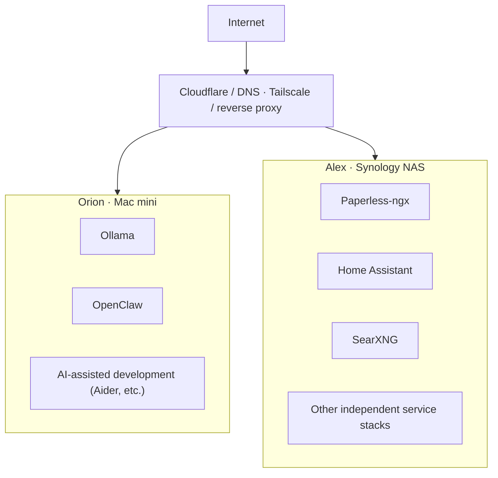

# Personal Infrastructure

Privacy-first self-hosted infrastructure running across a Mac mini and a Synology NAS, covering local AI, document management, home automation, and containerized services.

## Architecture

Two machines, two roles. Orion is a Mac mini handling local AI and development work. Alex is a Synology NAS running Docker/Portainer as the always-on home for self-hosted services. Access is mediated by Tailscale and a reverse proxy, with Cloudflare handling DNS where applicable. Nothing is exposed publicly by default.

See [architecture/architecture.md](architecture/architecture.md) for the reasoning behind this split.

## What this demonstrates

This repository is a portfolio, not a product — but the environment it documents is real, and I run it the way I'd want production infrastructure run:

- Infrastructure design that separates concerns by machine and by service
- Containerized deployment using independent, per-service Docker Compose stacks
- Secure remote access via Tailscale and a reverse proxy, with no incidental public exposure
- Local AI infrastructure (Ollama, AI-assisted development tooling) running on dedicated hardware
- Persistent storage and a defined backup boundary for application data
- Home automation running as a first-class self-hosted service, not a cloud dependency
- Ongoing operational maintenance: updates, monitoring for breakage, and deliberate tradeoffs rather than defaults

This is a personal environment where I apply production-style engineering discipline — not a claim that it *is* production infrastructure.

## Technology

| Category | Technology |
|---|---|
| Containerization | Docker, Docker Compose, Portainer |
| Networking / access | Tailscale, reverse proxy, Cloudflare (DNS) |
| Local AI | Ollama, OpenClaw, Aider |
| Self-hosted services | Paperless-ngx, Home Assistant, SearXNG |
| Version control | Git |

Only technologies actually in use are listed here.

## Repository navigation

- [Architecture](architecture/architecture.md) — machine roles, why workloads are split, service design
- [Deployment](docs/deployment.md) — how services get from Git to running containers
- [Security](docs/security.md) — remote access, exposure, secrets, network separation
- [Backup & Recovery](docs/backup-recovery.md) — what's backed up, what isn't, and why

## Why this exists

Most of my engineering work lives in private company repositories, so there's no public record of how I actually design and operate systems. This repository is that record: a real, running personal environment documented the way I'd document infrastructure at work — architecture first, honest about tradeoffs and gaps, and free of anything that reads like a tutorial.

It's intentionally small. The goal is for an interviewer to understand how I think about systems in a few minutes, not to browse a large codebase.
