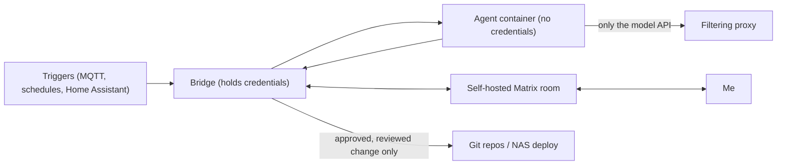

# Agent Platform

I run a small set of unattended AI agents (Claude Code) that maintain parts of the environment: one keeps dependency and image versions current, one writes this documentation, and a few are scoped to individual services such as document management and budgeting. This describes the design, not the configuration.

## Principles

- **Agents propose, I approve.** An agent never applies a change itself. It produces a reviewed diff or a question; nothing ships until I approve it.
- **Approve applies exactly what was reviewed.** Approval is tied to the specific commit or edit set I looked at, so the agent can't swap in something different afterwards.
- **Agents hold no keys.** Credentials (git access, service tokens, the container runtime) live in small separate "bridge" processes. The agent container gets none of them.
- **Least privilege per agent.** Each agent sees only the repository it works on, with sensitive paths hidden or read-only.

## Containment

Each agent run is a short-lived, hardened container:

- non-root, read-only root filesystem, capabilities dropped, memory/CPU/process limits
- a timeout and a turn cap per run, and a lock so runs don't overlap
- only its own working directory mounted
- egress through a filtering proxy on an internal-only network that allows the model API and nothing else; telemetry and non-essential traffic are disabled
- authenticated with a subscription token, not a general-purpose API key

## Human-in-the-loop channel

Agents talk to me through a self-hosted Matrix server, one room per agent. Questions and results are posted in full, and I answer by replying in the room. Home Assistant notifications are the fallback if Matrix is unreachable. Matrix messages and bridge actions are handled by plain code, not by the agent.

## Two examples

- **Update keeper.** A script inventories every pinned version across my repositories, looks up newer releases and release notes, and gives the agent only that. The agent chooses upgrade, pin, or hold among the offered versions. On approval, the bridge applies exactly the reviewed edits, commits, pushes, and redeploys NAS services one at a time with a health check. If it can't confirm exactly which version a running service is on, it offers no change for that service rather than guessing from the registry's latest tag.
- **Docs writer.** This repository is maintained by an agent that reads a digest of what changed in my private repos and edits only `README.md`, `architecture/` and `docs/`. A write allowlist and an automated leak check gate any push, and it never pushes itself. Only very public information belongs here, so when in doubt the agent leaves a detail out. The leak check covers file contents and commit messages, and blocks identifiers such as hostnames, addresses, ports, chat IDs and any domain not on a short list of public projects and vendors.

## Pinning and testing

Container base images are pinned by digest and key tools by version, so rebuilds are reproducible, and a test enforces it. The platform has an offline test suite (no network) covering allowlists, approval snapshots, forged references, symlink tricks, and command-injection cases in the bridges.

## Honest limits

- The agents' host is a Mac running a Linux VM for containers; it isn't highly available.
- Isolation is container-level, not a separate machine.
